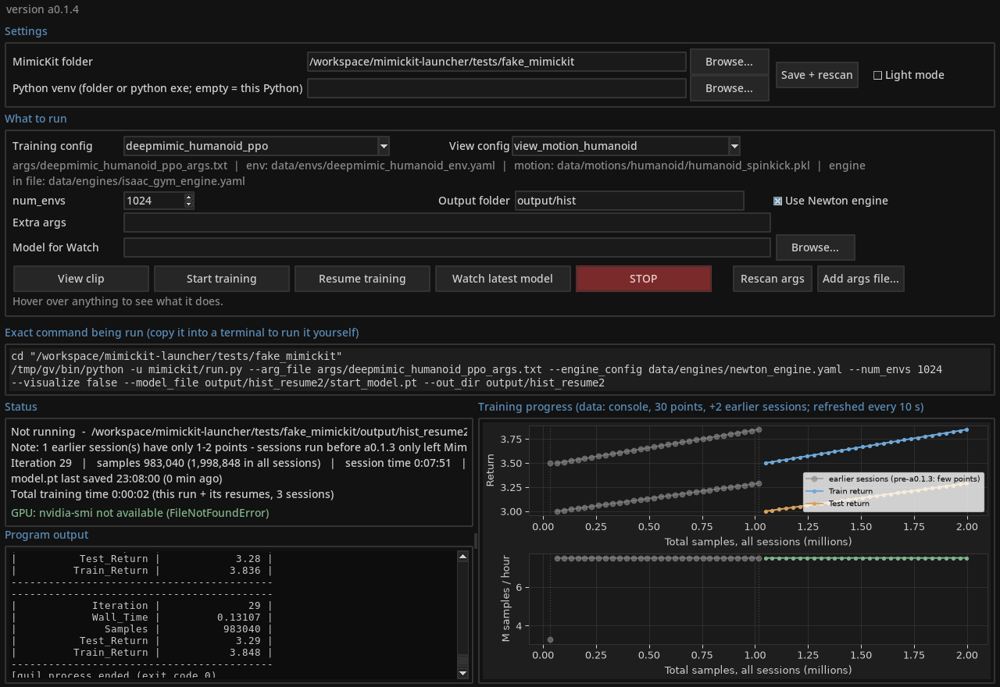

# MimicKit Launcher

A small desktop GUI (Windows and Linux) for running [MimicKit](https://github.com/xbpeng/MimicKit):
pick a config, press **Start training**, and watch the reward graph, GPU memory and log - no command line needed.

> ## ⚠️ Vibe coded
> This tool was **built with an AI assistant by someone with little coding experience**.
> It has had **light testing only** (an automated GUI test against a fake MimicKit folder, a real MimicKit clone,
> and day-to-day use on one Windows PC with an 8 GB GTX 10-series card). Expect rough edges.
> It comes with **no warranty of any kind** (see [LICENSE](LICENSE)).
> **Issues and contributions are very welcome** - see [CONTRIBUTING.md](CONTRIBUTING.md).
>
> This project is **not affiliated with MimicKit** or its authors.



## Features

- **Finds your configs automatically**: scans MimicKit's `args/*.txt`, splits them into *training* configs
  (DeepMimic, AMP, ASE, ADD, ...) and *view* configs (`view_motion_*`), and fills in `num_envs`, output folder,
  motion file and engine from each file.
- **Custom args files** (your own characters) and an **Extra args** box for any extra command-line options.
- **View clip / Start training / Resume training / Continue from run / Watch latest model / Render preview MP4 / STOP** buttons.
  - Start warns before overwriting an earlier run.
  - Resume copies the newest `model.pt` into a new `_resumeN` folder and continues from it (nothing is overwritten).
  - **Continue from run...** starts the *currently selected* config from the newest `model.pt` of any other run chain
    (pick its folder). Typical use: train a character on one clip, then continue the same policy on a bigger dataset or
    another motion. It goes into the current output folder, or its next `_resumeN` folder if that one is already used.
    The source folder is recorded as the parent (`launcher_time.json` + `launcher_link.json`), so total training time,
    session count and the chart history (grey, with dotted links) carry over - also across several hops.
  - **Watch** is chronological: one character, starting at the beginning of the clip, no random starts and no early
    resets. The launcher writes a copy of the config's env yaml with `rand_reset`, `enable_early_termination` and
    `pose_termination` off and a long `episode_length` to `output/_launcher_watch/view_env.yaml` (your `data/` folder
    is never changed) and passes it with `--env_config ... --num_envs 1`.
  - **Render preview MP4** - see below.
  - STOP kills the whole process tree (`taskkill /T /F` on Windows, process-group kill on Linux).
- **Runs survive the launcher closing or crashing**: MimicKit is started detached (Windows: new process group with a
  hidden console; Linux: its own session) and writes straight into the run's `console_log.txt`; the launcher tails that file.
  PID, command and start time are saved to `launcher_run.json`, so the next launcher window **reattaches** to a still-running
  training or Watch run (replays the log, keeps tailing, timers stay correct). STOP still kills the whole process tree.
  Closing the window while something runs asks whether to keep it running in the background.
- **Command echo**: shows the exact command it runs, so you can copy it into a terminal.
- **Live progress** parsed from MimicKit's console tables (`| Iteration | N |`), with `log.txt` as a fallback when watching a run the launcher did not start (MimicKit writes log.txt rarely, so it can lag): iteration, samples, training time, samples/hour,
  last `model.pt` save, plus charts of Train/Test return and speed.
- **Total training time across resumes**: "Running for (this session)" and "(total)" lines, saved every 10 s to
  `launcher_time.json` in each run folder (older runs are seeded from `log.txt` Wall_Time). Viewing/watching isn't counted.
- **Chart history across resumes**: per-iteration rows are saved to `chart_history.csv` in each run folder; on resume the
  whole chain (original + `_resumeN`) is drawn on one cumulative samples axis, earlier sessions in grey.
- Each training session also saves its console output to `console_log.txt`, so the chart history can be rebuilt later.
  Sessions without a saved history fall back to MimicKit's `log.txt` (written rarely), so they may show only a few points.
- **Progress estimate** (rough) in the Status panel: by default it fits a levelling-off curve to Train_Return over the
  whole run chain (smoothed, recent data weighted more, post-resume dips ignored) and shows e.g.
  `Plateau estimate: ~80% (about 6 h left) - rough`, or *not enough data yet* until the fit is stable. Optionally set a
  **target** (total samples, or a score - with "may not be reached" if the curve levels off below it); saved per run chain.
  It can't foresee later breakthroughs, so treat it as a hint.
- **GPU monitor**: polls `nvidia-smi` every 5 s (memory, utilization, temperature).
- **"Use Newton engine"** switch (on by default) - adds `--engine_config data/engines/newton_engine.yaml`,
  since Isaac Gym does not run on Windows.
- **Dark mode** by default, with a Light mode toggle. Hover tooltips on everything.
- First-run setup asks for your MimicKit folder and auto-detects a venv (`.venv` / `venv` inside or next to it);
  otherwise it uses the Python that runs the launcher.
- One file, standard library + matplotlib. Settings live in `%APPDATA%\mimickit-launcher\settings.json`
  (Windows) or `~/.config/mimickit-launcher/settings.json` (Linux).

## Preview MP4 (no GPU memory needed)

**Render preview MP4** makes a short video of the newest `model.pt` (or the file in *Model for Watch*) while training
keeps running:

1. A separate background process (detached like training runs, so it can't take training down) runs MimicKit's own
   `build_env` / `build_agent` with **`--devices cpu`, no window** and the GPU hidden, using the chronological view
   env (above). **Every training motion is previewed (the first 4)**: the env's motion list is read (a single `.pkl`
   or a dataset `.yaml`), one env is built per motion and each env is forced onto its own motion id from t=0
   (MimicKit's reset would otherwise sample a motion at random). Each clip plays for its own full length
   (`ceil(clip seconds x 30)` steps, deterministic actions, episode ends ignored); the character's joint state is
   logged per frame - plus the **reference pose** of that clip (same motion id, same time, from the motion library).
2. Plain **MuJoCo on the CPU** loads the character's MJCF, poses it frame by frame (Newton's joint order/quaternions are
   converted to MuJoCo's, and checked against Newton's body positions - the log shows the difference), renders with a
   tracking camera on all CPU cores (one renderer per worker) and streams the frames into an H.264 MP4 (30 fps).
3. **Reference ghost** (dropdown next to *Preview device*, saved in the settings, per clip): *Overlay* (default)
   draws the reference as a translucent orange character in place on top of the policy; *Side by side* offsets it
   sideways (the env's `ref_char_offset`, default 2 m) with the camera framing both; *Off* = policy only. A small
   Policy / Reference legend sits in the corner.
   **Clip layout** (with 2+ motions): *All at once* (default) = a 1x2 or 2x2 grid, one camera per clip, shorter clips
   hold their last frame; *One after another* = the clips in sequence. Each panel is labelled with its clip file name.
4. The video is saved as `preview_<iteration>.mp4` next to the model and opened with your default player.

Progress and messages appear in the log panel. **RAM limit:** the preview uses at most 80% of the RAM that is free
when it starts; render workers are sized to fit, the memory of its processes is watched, and it stops cleanly with a
message if it gets close. **Preview device** (below the buttons) - each attempt is a fresh process and the log names
the variant that ran (`PREVIEW VARIANT ...`):

| Stage | Variant | What it does |
|---|---|---|
| a | `cpu-hidden` | CPU, GPU hidden (`CUDA_VISIBLE_DEVICES=-1`), `PYTORCH_JIT=0`, crash tracebacks on (`PYTHONFAULTHANDLER=1`) |
| b | `cpu-visible` | if a crashes: CPU with the GPU visible but unused (forced `cpu` device, guard against stray CUDA launches, `PYTORCH_JIT=0`); aborted if it takes more than ~300 MB of GPU memory (nvidia-smi per process, or the growth of total use where Windows reports N/A) |
| c | `gpu` | if both fail or the CPU is >20x slower than real time: `cuda:0`, 1 env, refused if less than ~600 MB VRAM is free |

*Auto* (default) = a -> b -> c; *CPU only* = a -> b; *GPU* = c. Rendering is always on the CPU.

**Preview diagnostics** (button next to the dropdowns) runs probes P1-P7, each in its own process with crash
tracebacks and step checkpoints: P1 versions/devices, P2 torch with the GPU hidden, P3 `torch.jit.script` with the GPU
hidden, P4 a Warp CPU kernel compile + launch, P5 MimicKit env module + mujoco imports, P6 `build_env` on the CPU,
P7 a 30-frame recording per CPU variant (a and b). The report goes to the log panel and
`output/_launcher_preview/preview_diagnostics.txt` - attach that file when reporting a preview crash.

Measured on an 8-core CPU (no GPU), 3.5 s clip, 11-joint character: ~3 s setup, recording ~11 s (about 0.3x real
time), rendering 640x480 ~4 s with 7 workers, peak RAM ~2.3 GB; about 25 s in total. The first run compiles Warp's CPU
kernels once (~20 s extra; cached afterwards).

Needs, in the MimicKit venv: `mujoco` (already there with Newton/mujoco-warp), `imageio` + `imageio-ffmpeg`
(`pip install imageio imageio-ffmpeg`; MimicKit's `moviepy` usually brings them), optionally `psutil` (more exact RAM
numbers; `wandb` brings it).

**Chart navigation (no modes to pick):** drag with the left mouse button to move along the time axis - both charts
always show the same time range. The mouse wheel zooms the time axis at the cursor. The vertical scale stays at each
chart's full data range; a chart can be dragged up/down only when it has visible data outside its vertical range.
**Home** (or a double-click) returns to the full view and follows new data again; **Save picture...** writes a PNG/SVG/PDF.
The view is kept through the 10 s refresh. Tick **Current session only** to see just the running session on the time axis.
Light/dark mode switches the charts live as well.

The preview uses its own Warp kernel cache (`output/_launcher_preview/warp_cache`), so it never touches the cache a
running training uses; the first preview (and the first GPU fallback) compiles its kernels once.

**OpenGL note:** `mujoco.Renderer` needs a working OpenGL context. On Windows it uses the normal graphics driver -
if the preview fails with an OpenGL/WGL error, update the GPU driver, and note that some Remote Desktop sessions have
no OpenGL. On Linux the preview tries EGL, then OSMesa, then GLFW (needs a display) by setting `MUJOCO_GL`; set it
yourself to force one.

## Phone dashboard and notifications (optional)

**Settings -> Phone + notifications...** (everything off by default):

- **Phone dashboard** - a small read-only web page served by the launcher (Python standard library, in a background
  thread; it never blocks the window or touches training): status, session/total time, samples/hour, VRAM bar,
  progress estimate, both charts (touch zoom/pan of the time axis), the newest preview MP4 (streams with HTTP range
  requests), and a *Render preview* button (same background pipeline as the window's button, at most one per 5 min).
  No start/stop from the web. Every request needs the random access token from the dialog (link + QR code if the
  `qrcode` package is installed). Port 8765 by default; listen on 0.0.0.0 (other devices, e.g. over Tailscale) or
  127.0.0.1 (this PC only). Use **Tailscale** to reach it from anywhere - see [docs/REMOTE_ACCESS.md](docs/REMOTE_ACCESS.md).
  **Never forward the port on your router.**
- **Notifications** - Discord webhook and/or Telegram bot (token + chat id): a chart picture + status every N hours
  (default 3), optionally each new preview MP4 (skipped with a note if over the upload limit). *Send test* button.
  Stored only in your local settings file; failures are logged, never fatal.

## Requirements

- Windows 10/11 or Linux, an NVIDIA GPU with a recent driver.
- A working MimicKit install (see below).
- Python 3.9+ with **tkinter** and **matplotlib** to run the launcher. The MimicKit venv already has matplotlib;
  python.org installers include tkinter. On Linux: `sudo apt install python3-tk`.

## Install and run the launcher

**Easiest (Windows):** download/clone the repo and double-click **`MimicKit Launcher.exe`**. It is a tiny starter
(source in `tools/exe-starter/`) that finds your venv's `pythonw.exe` (from the launcher settings, a `.venv`/`venv`
next to MimicKit, the `MIMICKIT_LAUNCHER_PYTHON` variable, or `pythonw` on PATH) and runs `mimickit_launcher.py`.
If it can't find Python it shows a message saying where it looked. Keep the .exe next to the .py file.
A stand-alone PyInstaller build can be made with the GitHub Actions workflow `.github/workflows/build-exe.yml`.

Or from a terminal:
```bat
git clone https://github.com/curelessSky/mimickit-launcher.git
cd mimickit-launcher
launch.bat
```
Linux: `./launch.sh`. If `launch.bat` picks the wrong Python, run it directly with your MimicKit venv:
`C:\path\to\MimicKit\.venv\Scripts\pythonw.exe mimickit_launcher.py`
(or set the `MIMICKIT_LAUNCHER_PYTHON` environment variable to that path).

On first start, choose your MimicKit folder (the one containing `mimickit\run.py` and `args\`).
The launcher runs MimicKit with the venv Python it finds (you can change it in **Settings**).

## Installing MimicKit on Windows (step by step)

Done in a normal Command Prompt. Python **3.11** from python.org is recommended.

```bat
cd C:\ml
git clone https://github.com/xbpeng/MimicKit.git
cd MimicKit
py -3.11 -m venv .venv
.venv\Scripts\activate
python -m pip install --upgrade pip
pip install torch --index-url https://download.pytorch.org/whl/cu126
pip install "newton[sim]==1.0.0" "warp-lang==1.12.1"
pip install -r requirements.txt
```

Then download MimicKit's motion/asset data as described in the
[MimicKit README](https://github.com/xbpeng/MimicKit#readme) and unpack it into `MimicKit\data\`.

Quick sanity check:
```bat
python -c "import torch, warp, newton; print(torch.cuda.is_available(), torch.cuda.get_device_name(0), warp.__version__, newton.__version__)"
```
It should print `True`, your GPU name, and the versions.

Why these pins: MimicKit lists Newton **1.0.0** as tested (a plain `pip install newton` gets a newer one), and
**warp-lang must be pinned** because newer Warp releases break on older GPUs (next section) and Warp 1.18+
needs newer drivers/GPUs. `warp-lang==1.12.1` is the version known to work with Newton 1.0.0 here.
`requirements.txt` may try to change these; if so, re-run the `pip install "newton[sim]==1.0.0" "warp-lang==1.12.1"` line afterwards.

## MimicKit patches (optional, reversible)

**Settings -> MimicKit patches...** shows small changes the launcher can make to your MimicKit install, each with its
status (applied / not applied / unknown), **Apply** and **Revert**. Before the first change the original file is copied
to `<file>.launcher_orig`; applying or reverting twice changes nothing, line endings are kept, and if MimicKit's file
no longer contains the expected line the launcher refuses and leaves it alone. Changes affect runs started afterwards.

- **Logging** (`mimickit/learning/base_agent.py`): MimicKit already computes `Train_Episode_Length` /
  `Test_Episode_Length` but logs them as *quiet* (log.txt only). The patch removes `quiet=True` from those two log
  calls so they appear in the console table the launcher reads live. Cost: two extra table rows per iteration.
- **Solver** (`mimickit/engines/newton_engine.py`): the GTX 10-series fix below (`solver="cg", jacobian="sparse"`).

**Avg reward per step** = Return / episode length, in %. In DeepMimic-style tasks each step's reward is 0..1, so 100%
means perfect tracking on every step; unlike Return it doesn't rise just because episodes get longer. It is shown in
Status (train and test), as an optional third chart (*Per-step chart* checkbox) and on the phone dashboard. Without the
logging patch the launcher reads it from log.txt (MimicKit writes that less often) or says it needs the patch.

## GTX 10-series / Pascal (sm_61) fix

Two problems hit Pascal cards (GTX 1050-1080, Titan Xp, P100...):

1. **`WarpCodegenKeyError: Referencing undefined symbol: J_kj`** - Warp **1.16 and newer** check kernel code more
   strictly, and a kernel in `mujoco_warp` (the solver Newton uses) references a variable that is only defined in one
   branch. Older Warp compiles it fine. **Fix:** `pip install "warp-lang==1.12.1"`.
2. **`libmathdx ... cuFFTDx error` / `tile_matmul` / `tile_cholesky` failures** - MuJoCo-Warp's default
   `solver="newton"` with dense Jacobians uses Warp *tile* kernels built on NVIDIA MathDx (cuBLASDx/cuSolverDx),
   which do not support compute capability 6.1. **Fix:** use the conjugate-gradient solver with sparse Jacobians,
   which avoid those tile kernels. In `MimicKit\mimickit\engines\newton_engine.py`, in `_build_solver`, change

   ```python
   solver="newton",
   ```
   to
   ```python
   solver="cg", jacobian="sparse",
   ```
   One-liner from the MimicKit folder (PowerShell):
   ```powershell
   (Get-Content mimickit\engines\newton_engine.py) -replace 'solver="newton",', 'solver="cg", jacobian="sparse",' | Set-Content mimickit\engines\newton_engine.py
   ```
   CG converges a bit differently than Newton's method, but training works fine. Newer GPUs don't need this.
   The launcher can apply and revert this for you: **Settings -> MimicKit patches...**.

## VRAM tuning (`num_envs`)

`num_envs` = how many characters are simulated in parallel. More is faster per hour but uses more GPU memory
(roughly linear). Measured on an **8 GB GTX 10-series card** with the Newton engine:

| num_envs | VRAM used |
|---------:|----------:|
| 1024 | ~1.6 GB |
| 4096 | ~5.5 GB |
| 5120 | ~6.8 GB |

If you get `CUDA out of memory` or the PC becomes unresponsive, lower `num_envs` (e.g. 4096 -> 2048).
Leave ~1 GB free for Windows. Watch the GPU line in the launcher while training starts.

## Troubleshooting

| Problem | Fix |
|---|---|
| "MimicKit not found" | Settings -> MimicKit folder must contain `mimickit\run.py`. Then **Save + rescan**. |
| No configs in the lists | The `args` folder is missing or empty - re-clone MimicKit. |
| `No module named torch` / wrong packages | Settings -> Python venv must point at the venv you installed MimicKit into (folder or `python.exe`). |
| `torch.cuda.is_available()` is False / `no kernel image` | Reinstall torch: `pip uninstall -y torch` then `pip install torch --index-url https://download.pytorch.org/whl/cu126` |
| `J_kj` codegen error, `libmathdx`/`tile_matmul` error | See the Pascal section. |
| Isaac Gym import errors on Windows | Keep **Use Newton engine** on. |
| Out of memory | Lower `num_envs` (see above). |
| GPU line says `nvidia-smi not available` | Install/update the NVIDIA driver, or ignore it (only the monitor is affected). |
| Charts stay empty | They fill from the console output after the first iteration table. For runs started elsewhere they read `log.txt`, which MimicKit writes rarely. |
| Launcher doesn't open on Linux | `sudo apt install python3-tk` and `pip install matplotlib`. |
| STOP didn't stop it | Press again; on Windows check Task Manager for leftover `python.exe`. |

## Running the tests

```bash
xvfb-run -a python tests/gui_test.py                 # fake MimicKit tree in tests/fake_mimickit
xvfb-run -a python tests/gui_test.py /path/MimicKit  # real clone (only builds commands; MimicKit deps not needed)
STUB_REPLAY=console.txt STUB_LOG=log.txt xvfb-run -a python tests/replay_test.py  # replay a real console capture
STUB_CRLF=1 STUB_SLEEP=0.008 VERIFY_AT=24 STUB_REPLAY=console.txt xvfb-run -a python tests/replay_test.py  # Windows-like: CRLF, never flushed, slow
xvfb-run -a python tests/time_test.py      # total training time: start/stop/resume/kill/legacy
xvfb-run -a python tests/history_test.py   # chart history across two resumes
xvfb-run -a python tests/detach_test.py    # runs survive the GUI: detach, reattach, stop
xvfb-run -a python tests/chain_test.py     # Continue from run: chains across folders (time + history), view env yaml
# preview pipeline end to end - needs a real MimicKit install; run with its venv python:
PREVIEW_TEST_MK=/path/MimicKit PREVIEW_TEST_PY=/path/MimicKit/.venv/bin/python PREVIEW_TEST_ARGS=args/<training args>.txt \
  xvfb-run -a /path/MimicKit/.venv/bin/python tests/preview_test.py
xvfb-run -a python tests/nav_test.py      # chart navigation, light/dark charts, single-instance tooltips
xvfb-run -a python tests/patch_score_test.py  # MimicKit patches apply/revert, per-step score, URL order + QR refresh
xvfb-run -a python tests/remote_test.py   # phone dashboard (token, range requests, rate limit), notifications (mocked), GUI responsiveness
# same env vars: reference ghost (both modes), staged CPU fallback (simulated crash), diagnostics
  xvfb-run -a /path/MimicKit/.venv/bin/python tests/ghost_test.py
# + PREVIEW_TEST_MULTI_ENV=data/envs/<env with a 2+ motion dataset>.yaml: multi-motion preview, both layouts
  xvfb-run -a /path/MimicKit/.venv/bin/python tests/multi_test.py
# PREVIEW_TEST_VIEW_ARGS=args/<view args>.txt: preview of view (motion playback) presets
  xvfb-run -a /path/MimicKit/.venv/bin/python tests/view_test.py
```

## Credits

- [MimicKit](https://github.com/xbpeng/MimicKit) by Xue Bin (Jason) Peng and contributors, Apache-2.0 license.
  This launcher only calls MimicKit's `run.py`; it contains no MimicKit code. **Unaffiliated with MimicKit.**
- [NVIDIA Warp](https://github.com/NVIDIA/warp), [Newton](https://github.com/newton-physics/newton),
  [MuJoCo Warp](https://github.com/google-deepmind/mujoco_warp).
- Built with an AI assistant (see the disclosure at the top).

## License

Copyright (c) 2026 curelessSky, licensed under GPL-3.0-or-later - see [LICENSE](LICENSE).
